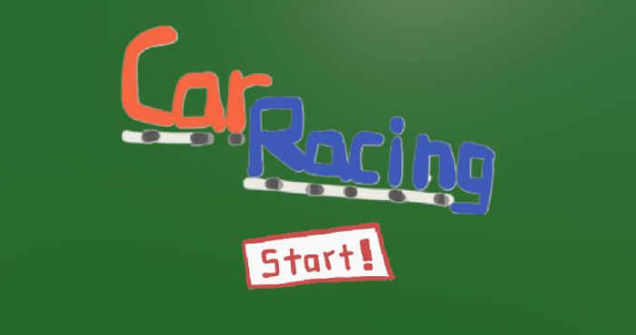
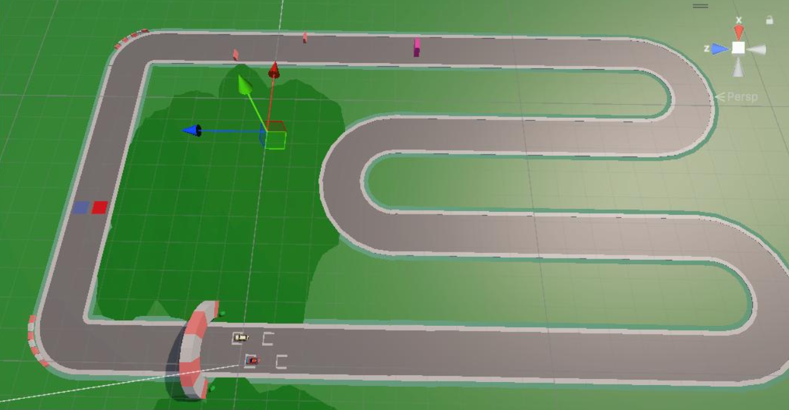
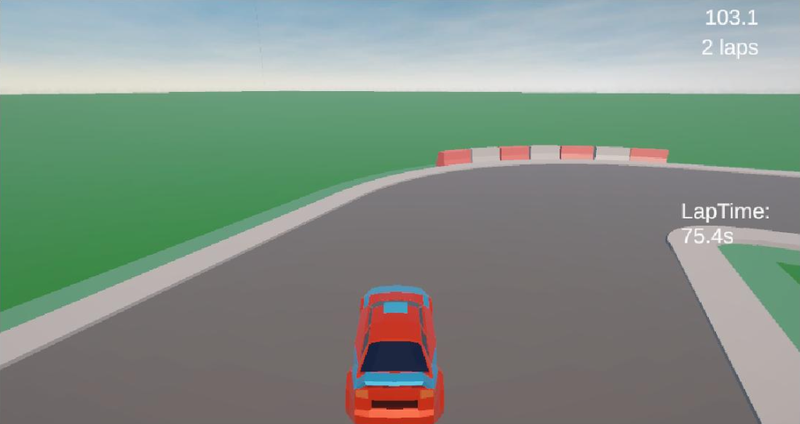

# car-race-game-cg
「乗り物でフィールドを走り回るアプリの作成」課題  
コンピュータグラフィックスを作成する際に必要な基本アルゴリズムを習得，処理方法などの基礎概念を理解することを目的とした授業にて。  

## 遊び方
spaceキー　 ブレーキ  
矢印キー　上　発進  
　　　　　下　バック  
　　　　　右　右にハンドルを切る  
　　　　　左　左にハンドルを切る  

## 工夫点
* タイトルとスタートボタンはイラストを描き、押せるボタンとして実装
* 矢印キーから手を離すと徐々に減速する
* 周回の回数はスタート地点に、透明なCheckPoint Boxを設置。OncollisionEnterでカウントするようになっている。

### イメージ画像
  
  
  

## 使用アセット
* Rally Cars  
https://assetstore.unity.com/packages/3d/vehicles/rally-cars-215152  
* Racing Starter Kit FREE  
https://assetstore.unity.com/packages/templates/systems/racing-starter-kit-free-169750  
* Low Poly Prototype Starter Pack - Polyworks  
https://assetstore.unity.com/packages/3d/environments/low-poly-prototype-starter-pack-polyworks-233973  